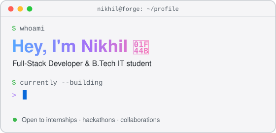

 

## Tech stack

**Languages** &nbsp;

**Frontend** &nbsp;

**Backend** &nbsp;

**Databases** &nbsp;

**ML & AI** &nbsp;

**Tools** &nbsp;

## Featured builds

| Project | What it does | Stack |
|---|---|---|
| [**Waterway**](https://github.com/NikhilForge/waterway) | Full-stack logistics planner for smart waterway routing and fleet coordination, with an AI agent and chatbot | React, TypeScript, Express, tRPC, Gemini |
| [**Rukia**](https://github.com/NikhilForge/rukiadiscordbot) | AI Discord assistant with web search, image input, persistent memory and automatic fallback across AI providers | Python, Supabase, Groq, Gemini |
| [**Jarvis Enhanced**](https://github.com/NikhilForge/Jarvis-Enhanced) | Always-on Windows voice assistant with local wake word, speech recognition and TTS, Gemini tool-calling, browser and desktop automation, speaker verification and a real-time 3D HUD. Enhanced fork of [psycoks/Jarvis](https://github.com/psycoks/Jarvis) | Python, Gemini, Whisper, FastAPI, Three.js, Playwright |
| [**House Price Predictor**](https://github.com/NikhilForge/AI-House-Price-Recommendation-System) | Machine learning house price predictor served through a FastAPI backend, with a web form generated dynamically from the model's features | Python, scikit-learn, FastAPI, JavaScript |
| [**Just Box**](https://github.com/NikhilForge/boxing-game) | Motion-controlled boxing rhythm game that tracks your punches through the camera, playable in the browser | JavaScript, MediaPipe, Web Audio API |
| [**Campus Lib**](https://github.com/NikhilForge/campus-lib) | Library management system with student and admin portals, borrowing workflow and recommendations | HTML, CSS, JavaScript, MongoDB |

## Open source contributions

<!-- OSS:START -->
_Merged contributions will appear here automatically._
<!-- OSS:END -->

[View all merged pull requests →](https://github.com/search?q=author%3ANikhilForge+type%3Apr+is%3Amerged+-user%3ANikhilForge&type=pullrequests)
